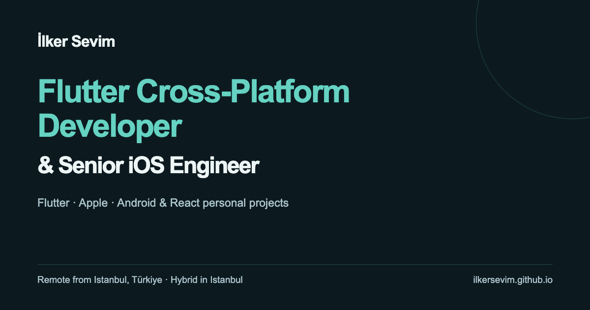

# İlker Sevim — Personal Website

[](https://ilkersevim.github.io/)
[](https://github.com/ilkersevim/ilkersevim.github.io/actions/workflows/deploy-pages.yml)
[](https://www.typescriptlang.org/)
[](https://vite.dev/)
[](https://nodejs.org/)

Professional website for İlker Sevim, Flutter Cross-Platform Developer & Senior iOS Engineer. Live at [ilkersevim.github.io](https://ilkersevim.github.io/). Flutter and Apple work leads; Android and React are personal portfolio projects. Work preference: remote from Istanbul, Türkiye; hybrid in Istanbul. The site includes technical evidence, dated test runs and separate Flutter / iOS CV downloads.



## For technical reviewers

Suggested reading order:

| Priority | What to open | Why |
| --- | --- | --- |
| 1 | [Flutter reviewer path](https://github.com/redjadet/flutter_bloc_app#reviewer-path) | Persist and replay offline counter writes; stale-read and queue regressions |
| 2 | [Apple three-minute path](https://github.com/redjadet/super_demo_ios/blob/main/docs/portfolio.md#3-minute-path) | Preserve the latest bookmark intent during an in-flight request; macOS and local watchOS / tvOS demos |
| 3 | [Android three-minute path](https://github.com/redjadet/super_demo_android/blob/main/docs/portfolio.md#3-minute-path) | Room transaction race, offline feed, CRUD and deep links |
| 4 | [This repository](https://github.com/redjadet/react-web-portfolio) | Viewport-height navigation geometry, nine locales and accessible controls |

Each project card links design evidence and relevant regressions. Mobile test links are pinned to the commit of the linked successful run, with its date visible. A test file alone is not a passing result. [Validation record](docs/validation/2026-10-20-flutter-first.md) explains the checked scope and publication gate.

Contact: [ilkersevim2007@gmail.com](mailto:ilkersevim2007@gmail.com) · [LinkedIn](https://www.linkedin.com/in/ilker-sevim-95020820/) · [GitHub](https://github.com/redjadet)

## Engineering choices

- Small React components with typed content separated from presentation.
- CSS Modules and shared design tokens; responsive layouts without a UI framework.
- Semantic headings, skip navigation, descriptive external links, visible keyboard focus and reduced-motion support.
- Portrait dimensions reserve space; no analytics, tracking scripts or pretend contact form.
- Canonical URL, robots/sitemap, Person structured data and Open Graph metadata.
- GitHub Pages org-site deployment (`ilkersevim.github.io`) with frozen dependency installation, lint and TypeScript/build checks.

## Local development

Requires Node 24+ and pnpm (see `.nvmrc`).

```bash
pnpm install --frozen-lockfile
pnpm dev --host 127.0.0.1 --port 43123
```

Open http://127.0.0.1:43123/

```bash
pnpm lint
pnpm test        # Vitest watch
pnpm test:run    # CI-friendly single run
pnpm check       # lint + test:run + production build
pnpm preview
```

Pre-merge gate: [docs/pre-merge-checklist.md](docs/pre-merge-checklist.md). PRs use `.github/PULL_REQUEST_TEMPLATE.md`. GitHub Actions workflow **CI** runs lint, tests, and build on PRs and `main`.

## Update content

Edit `src/content/profile.ts`, `projects.ts`, `projectCatalog.ts`, `skills.ts` and `src/i18n/messages.ts`. Platform links and pinned run references live once in `projectCatalog.ts`; copy is translated in nine locales. Keep `index.html` defaults and the sharing image consistent with the English identity.

Put static assets in `public/`; reference them through `import.meta.env.BASE_URL` so asset paths stay correct for the org-site root (`base: '/'`). [Asset provenance](docs/portfolio-assets.md) records the real app screenshots and unchanged CV PDFs. The sharing image source is `scripts/og.html`: serve it with `pnpm dev`, open `/scripts/og.html` at 1200 × 630, then capture that viewport as `public/og.png`.

## Deploy

Live site source of truth for Pages is [`ilkersevim/ilkersevim.github.io`](https://github.com/ilkersevim/ilkersevim.github.io) (org site at `/`). Pushes to `main` there run `.github/workflows/deploy-pages.yml` and publish the app.

This repository (`react-web-portfolio`) remains the working clone and mirrors the same codebase. Legacy hosts stay alive as redirects:

- `https://redjadet.github.io/` → `https://ilkersevim.github.io/` (`redirect-usersite/`)
- `https://redjadet.github.io/react-web-portfolio/` → `https://ilkersevim.github.io/` (`redirect-pages/`)

## Manual review

Check desktop and 320–390px mobile layouts, keyboard navigation, section anchors, reduced motion, image loading and every project/contact link before publishing. Verify the deployment at the live URL after the Actions run completes.
