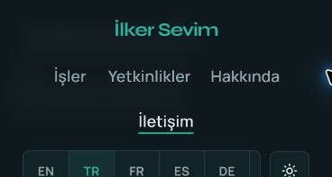
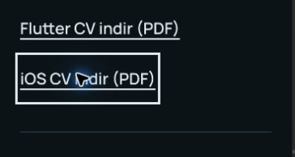

# Native browser zoom regression validation — 2026-10-20

This follow-up addresses two failures reproduced on the published application at `cfa2e336516e08e1c86398c7d5684cdb4023b9c8`: a sticky header covering the focused iOS CV link at 400% browser zoom, and Contact navigation leaving About active at 200%.

## Reproduction and fix

- At native 200% zoom, the viewport measured 735 × 393 CSS px. Clicking Contact reached `#contact`, with its top at 195.23px, but `aria-current` remained on About. Stored IntersectionObserver entries ranked sections using ratios from different moments; no new threshold crossing was guaranteed to replace them.
- At native 400% zoom, the viewport measured 367 × 196 CSS px. The wrapped Turkish header measured 224.75px high. Shift+Tab to the iOS CV link placed its rectangle at 71.73–124.73px, entirely behind that header. Hit testing at the focused link returned a header navigation link.
- The header now scrolls with the document when viewport height is at most `30rem` (480 CSS px at the default text size). Its measured sticky inset becomes zero in that mode, including when a resize changes positioning without changing header height.
- The root scroll container supplies the shared anchor/focus inset, replacing section-only margins. Taller screens keep the measured sticky-header offset; short screens use only the spacing token.
- Active navigation reads all four section rectangles from the current layout. Scroll, resize, hash changes and observed header/section resizing schedule one animation-frame update. The reading line uses viewport height and the current scroll inset; it does not retain intersection ratios.



## Automated regression evidence

The baseline suite passed 39 tests. Before changing the hook, a focused regression first delivered About through the existing observer mock, then moved Contact into the reading area and dispatched a scroll without another observer entry. It failed with `expected 'about' to be 'contact'`.

The updated [geometry tests](../../src/hooks/useActiveSection.test.tsx) cover forward/backward scrolling, an anchor below the header inset, returning above Work, viewport/inset changes, locale reflow, hash navigation, frame coalescing and cleanup. A [header regression](../../src/components/Header.test.tsx) checks sticky → static → sticky positioning with unchanged element height and listener cleanup. These are controlled geometry tests, not claims of native browser rendering.

The header regression was also run against the original `Header.tsx`: it failed with `expected '176px' to be '0px'`. Restoring the fix made the same test pass.

At 17:51 UTC (20:51 Istanbul) on 2026-10-20, Node **24.21.0** and pnpm **12.8.1** completed:

```bash
fnm exec --using 24 pnpm check
# lint: passed
# Vitest: 8 files / 42 tests passed
# TypeScript and Vite production build: passed
```

The production preview served `dist` at `http://127.0.0.1:43124/`. Validated application bundles:

| File | SHA-256 |
| --- | --- |
| `index-CU-5ANYi.css` | `f6a6a7720ea680b31ee58aa2e0e48fb5f9b6571ac31f86ef9889ba8e11ded61d` |
| `index-BDx-n_W4.js` | `bb6dd722f2a7bd5c5c0b336b14c1453dfd70852e21ff189fe7f8ff30395c0e16` |

## Browser results

Checks below used Brave on macOS on 2026-10-20, finishing at approximately 17:53 UTC (20:53 Istanbul). The browser's own zoom controls selected 200% and 400%; the corresponding `devicePixelRatio` values were 2 and 4. No viewport override, CSS text-size change or page-scale emulation was used for these native zoom checks. Measurements were taken after scrolling settled.

| Scenario | Observed result |
| --- | --- |
| Native 400%, 367 × 196, EN / TR / AR | Header position `static`; root top inset 20px. Shift+Tab returned from the footer to the iOS CV link, which remained visible. Hit testing reached that link rather than an overlay. No horizontal page overflow. Arabic remained RTL. |
| Native 200%, 735 × 393, TR | Work, Skills, About and Contact each selected their matching `aria-current="location"` link. Settled section tops were 19.78, 19.89, 19.75 and 20.11px respectively. Contact no longer retained About. |
| Native 100%, 1471 × 786, TR | Header returned to `sticky`, with bottom at 86px and root top inset 106px. Contact landed at 105.77px and selected Contact. Insets were not doubled. |
| Responsive override, 320 × 844, all nine locales | Tested separately at 100% native zoom. No horizontal page overflow; both named CV downloads present. Arabic set `lang="ar"`, `dir="rtl"`; other locales remained LTR. |
| Theme and reload | Light/dark switching worked; reload preserved Turkish and dark theme. |
| Diagnostics | No application console errors or warnings observed. Installed browser extensions emitted their own `chrome-extension://` warnings. |




VoiceOver remained off. Speech and rotor output were not tested. These results establish the exercised cases, not a complete WCAG conformance audit. The [focus-not-obscured criterion](https://www.w3.org/WAI/WCAG22/Understanding/focus-not-obscured-minimum.html) is the relevant requirement for the reproduced header failure.

## Recurrence and publication gates

The bug classes were stale callback geometry and a sticky overlay consuming a short viewport. Automated tests now exercise current geometry and inset lifecycle; the [pre-merge checklist](../pre-merge-checklist.md) and PR template also require native 200% / 400% zoom checks. Native zoom is independent of the earlier [200% text-enlargement record](2026-10-20-flutter-first.md).

This record describes local production-preview verification. Hosted checks and live publication remain separate delivery gates: ship the same merge commit to all three `main` branches, confirm the org-site Pages deployment, and repeat the reported zoom cases against `https://ilkersevim.github.io/`. Source-repository Pages publishes a redirect, so a green source build alone does not prove the website changed.
