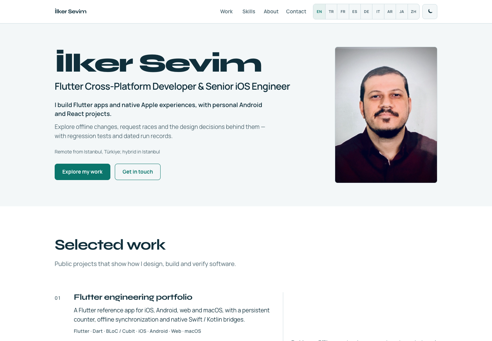
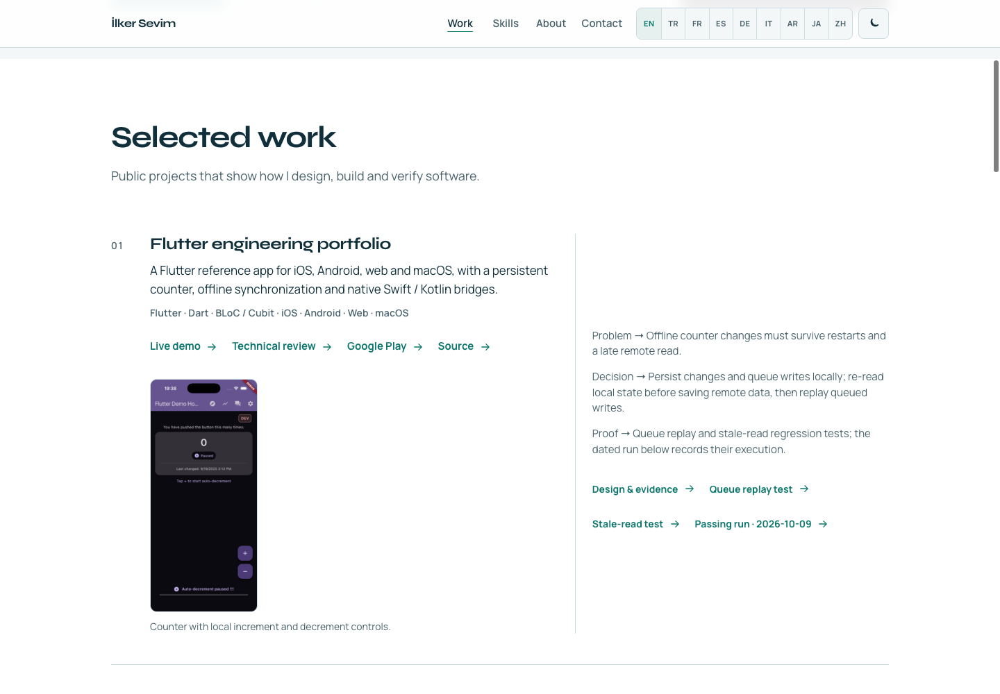
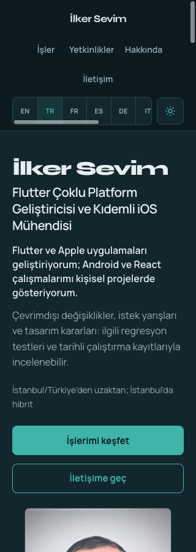
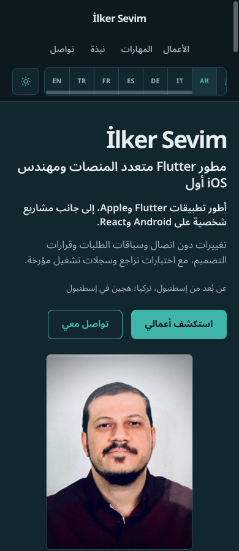

# Flutter-first portfolio validation — 2026-10-20

This record covers the production build preview of the Flutter-first portfolio update, based on `923fd4da8edfc2ffddd03aaaf37ef9775b36afce`. Local checks passed. Production publication remains a separate gate below.

## Environment and automated checks

- Node 24, pnpm 12.8.1, Chromium 155.0.8059.85 through Playwright.
- `pnpm install --frozen-lockfile` succeeded; the lockfile was unchanged.
- `pnpm check` succeeded at 14:17 UTC: lint, 7 Vitest files / 39 tests, TypeScript and Vite production build.
- New regressions cover viewport-height observer margins, viewport resize and cleanup, a wrapped header, partial observer callbacks, all nine locales' identity metadata, and the visible email name / CV download links.
- The browser checks used `pnpm preview --host 127.0.0.1 --port 43123 --strictPort`, serving `dist`.

## Browser results

| Area | Checked result |
| --- | --- |
| Identity | Flutter-first role, Flutter → Apple → Android → React project and skill order, explicit remote-from-Istanbul / Istanbul-hybrid preference. Android and React are personal projects. |
| Locales | EN, TR, FR, ES, DE, IT, AR, JA and ZH at both 320 × 844 and 390 × 844: 18 scenarios passed. Four project cards, two named CV downloads, localized title / metadata / `Person.jobTitle`, selected language visible, no horizontal overflow or clipped main links. |
| RTL | Arabic sets `lang="ar"`, `dir="rtl"`; header, language strip, actions and project copy remain readable. The language strip intentionally scrolls. |
| Keyboard | Skip link moves focus to `main`. Header links, all nine language buttons and theme control are reachable at 320px with visible 3px focus outlines. Project evidence and both CV links are reachable; the email button's accessible name is exactly its visible English text, “Email me”. |
| Enlargement | Root text at 200% (computed 32px), at 1280 × 900 and 320 × 900: no horizontal overflow or clipped interactive content. Contact grid and email wrapping were corrected after this check initially found overflow. This was text enlargement, not a native browser zoom or screen-reader test. |
| Theme | Light and dark views inspected. The theme control updates `data-theme`, stores `localStorage.theme` and preserves dark mode on reload. |
| JavaScript disabled | English fallback includes the new role, all four platforms, work preference and both working CV links. Static title, sharing metadata and structured data use the new identity. |
| Assets | All three app PNGs and the 1200 × 630 sharing image return HTTP 200 with correct dimensions. Both PDF downloads return HTTP 200 and match their original SHA-256 hashes. See [asset provenance](../portfolio-assets.md). |
| Console | No browser errors or warnings during the preview session. |

### Button contrast

Computed foreground/background colors were sampled after transitions settled. Ratios use WCAG relative luminance and exceed the [4.5:1 normal-text requirement](https://www.w3.org/WAI/WCAG22/Understanding/contrast-minimum.html).

| Button / theme | Normal | Hover |
| --- | --- | --- |
| Primary / light | 5.49:1 | 7.64:1 |
| Primary / dark | 7.08:1 | 8.51:1 |
| Email / light | 14.08:1 | 12.34:1 |
| Email / dark | 16.11:1 | 14.06:1 |

The email hover background also needed a dark-theme correction. Removing the email button's redundant `aria-label` keeps its [visible label in its accessible name](https://www.w3.org/WAI/WCAG22/Understanding/label-in-name.html).

### Real navigation geometry

The browser used its native IntersectionObserver. A forwarding subclass recorded actual options and callback `rootBounds`; it did not replace intersection calculations. Each header link (`work`, `skills`, `about`, `contact`) activated the corresponding menu item at all three viewport sizes. Anchor content cleared the measured sticky header. Observer rebuilding was also checked after viewport changes.

| Viewport | Root margin | Actual reading-band height |
| --- | --- | --- |
| 2560 × 1080 | `-432px 0px -486px 0px` | 162px |
| 320 × 900 | `-360px 0px -405px 0px` | 135px |
| 1440 × 700 | `-280px 0px -315px 0px` | 105px |

[IntersectionObserver percentage root margins resolve against root width](https://www.w3.org/TR/intersection-observer/#root-intersection-rectangle). The implementation now derives the band from viewport height in pixels and rebuilds it when the viewport or header changes. Unit observer mocks check lifecycle and state; the table above is the separate real-browser geometry evidence.

## Mobile project evidence and links

The mobile suites were not rerun for this React change. Each card links named regression source pinned to the commit of an existing successful run. Dates remain visible so these records are not mistaken for proof that the latest mobile `main` was tested here.

| Project | Design / regression | Verified successful execution |
| --- | --- | --- |
| Flutter | Offline counter persistence and queue replay; stale remote reads re-check local state before save. | [Flutter tests, 2026-10-09](https://github.com/redjadet/flutter_bloc_app/actions/runs/37902949216/job/113729610021), commit `5aa04771392fccf77dd3ea7fd0f11bb4a2cb6372`. |
| Apple | Atomic optimistic bookmark + outbox; preserve and drain a successor intent after an in-flight request. | [Unit tests, 2026-10-08](https://github.com/redjadet/super_demo_ios/actions/runs/37828018857/job/113485831800), commit `17d795f471aafae5010b5736d052b316cdedd02a`. macOS build evidence and local watchOS/tvOS snapshot scope have separate guide links; companion demos do not sync with a phone. |
| Android | Room transaction preserves a bookmark changed during refresh; separate offline feed, CRUD and deep-link regressions. | [Unit/lint/build CI](https://github.com/redjadet/super_demo_android/actions/runs/39417272605) and [API 34 emulator instrumentation](https://github.com/redjadet/super_demo_android/actions/runs/39417272616), 2026-10-20, commit `2d09e86001c73172a6dc4a4555197d9eaff346df`. |

GitHub contents and Markdown headings were checked for 15 reviewer/design/test targets. The Flutter link resolves to `#reviewer-path`; the Apple link resolves to `docs/portfolio.md#3-minute-path`. The Flutter web demo returns HTTP 200 with its Flutter bootstrap; its Google Play listing opens. The new React regression and validation links target files introduced by this change, so their `main` URLs become available when the source repository is merged.

## Current website captures

## Publication gate

The live publication path was inspected in `.github/workflows/deploy-pages.yml` and [the deployment checklist](../pre-merge-checklist.md):

| Repository | Uploaded Pages content |
| --- | --- |
| `ilkersevim/ilkersevim.github.io` | `dist` — the actual website |
| `redjadet/redjadet.github.io` | `redirect-usersite` — legacy redirect |
| `redjadet/react-web-portfolio` | `redirect-pages` — source/project redirect |

A pull request runs quality/build checks without deploying. A successful source-repository check alone does not establish that the public website changed. At the time of this record, the candidate is not published. Finish publication by syncing the same reviewed commit to all three `main` branches, waiting for the org-site Pages deployment, and checking the live title, four projects, metadata, PNGs, CV bytes and both legacy redirects. Record that deployment's SHA and run URL before claiming a live pass.

Separate language URLs remain a later SEO step. Language selection still uses the same URL; this change does not claim separately indexed language versions. See [Google's multilingual URL guidance](https://developers.google.com/search/docs/specialty/international/managing-multi-regional-sites).
